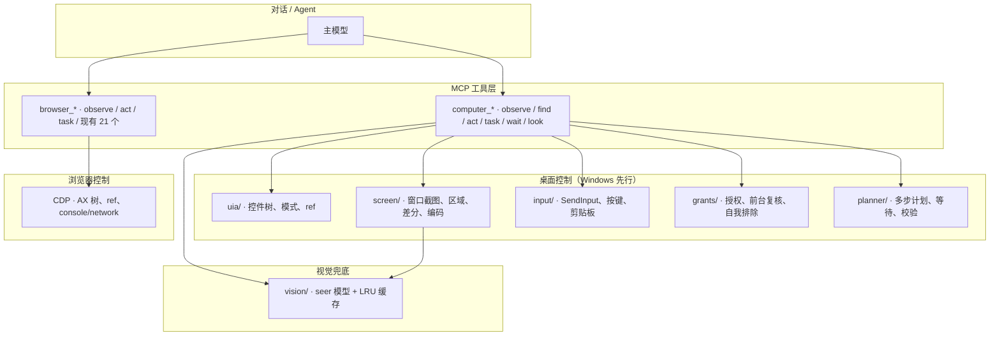
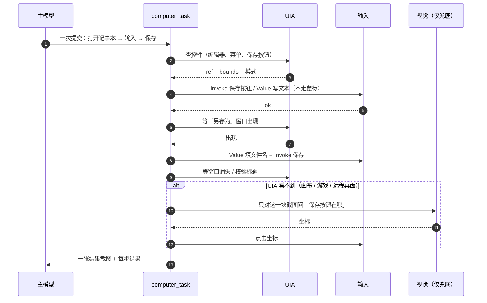

# 快速 Computer Use / Browser Use：实现细节

> 2026-10-27 · 细节稿；已并入主稿 `2026-10-27-magpie-parity-architecture.md` §8.19
> 问题：Codex 的 computer use 被反馈「太慢太烂」；Claude Code 也有 computer use；Magpie 也做了。
> 结论：**能做，而且我们现有的 `computer` + `browser` 是最好的底座；缺的不是模型，是「结构化感知 + 批量执行 + 视觉兜底」。**

---

## 0. 一句话结论

慢的根因不是模型不够强，而是**每一步都让模型看一张整屏截图、只做一个动作、再回来**。
把「看」换成 UI Automation / DOM 树，把「做」变成一次调用里的多步计划，把「看像素」降级成兜底，速度会差一个数量级。

---

## 1. 我们现在有什么

| 层 | 已有 | 缺口 |
|---|---|---|
| 浏览器（`server/src/web/`，21 个工具） | CDP 驱动、可访问性树（AX）+ ref 编号、`browser_find/click/type` 按 ref、控制台 / 网络 / 页面结构 / 等待 / 标签 / 视口、接管、网站闸、Agent 光标、自动检查 | 没有「一次调用跑多步」的 `browser_task`；没有统一的 `browser_observe` |
| 桌面（`server/src/computer/`，23 个工具，Windows） | 常驻 PowerShell + C# helper（SendInput、System.Drawing 截屏、窗口/进程查询）、per-monitor DPI、截图长边 ≤1568、区域放大、坐标换算、应用授权闸、前台窗口复核、剪贴板、系统键组合开关、`computer_batch` | **没有 UI Automation 树**、没有按名字找控件、没有任务计划器、没有视觉兜底 |
| 视觉 | 只有图片型工具的 `alwaysLoad` | 没有独立的「看图模型」（seer）和描述缓存 |

> 浏览器这一层已经很强，用户说「browser use 好像有了」——对，不用重做，只补批量与统一观察。
> 桌面这一层是这次的重点。

---

## 2. 为什么 Codex / Claude / Magpie 的 computer use 慢

| 做法 | 后果 |
|---|---|
| 每一步截一整屏，发给视觉模型 | 一次截图 + 一次视觉推理，几百毫秒到几秒；屏幕越大越慢 |
| 模型每次只返回一个动作 | 一个 5 步任务 = 5 次以上模型往返 |
| 靠坐标猜控件 | 猜错就重来；分辨率、DPI、多显示器都会错 |
| 没有控件树 | 明明可以「按名字点按钮」，却只能「看图找像素」 |
| 没有缓存 | 同一屏反复描述；Magpie 为此做了 `sightsKept`（2048 条描述 LRU） |
| 截图不裁剪 | 全屏 base64 很大，MCP 传输和模型输入都贵 |

- Claude Code 的 computer use 本质也是「tool_use → 执行 → 回截图」的循环（官方文档明确写这个 loop）。
- Codex Desktop 的 Computer Use 插件同样是截图驱动；社区反馈慢、UI 卡。
- Magpie 的贡献是：**用另一个小的「看图模型」把截图转成文字，并按图片哈希缓存**（`internal/gateway/vision.go`、`vision_mcp.go`），让看不见图的模型也能用；但它本身仍是一个截图循环。
- 我们不要重复这个循环，而是**先走结构化的路**。

---

## 3. 目标

| 指标 | 目标 |
|---|---|
| 本地动作（点击 / 按键 / 打字） | < 100 ms |
| `computer_observe`（UIA 树） | < 200 ms |
| `computer_observe`（视觉兜底） | < 1.5 s |
| 一个 5 步任务的模型往返 | 从 5+ 次降到 1–2 次 |
| 任务成功率 | 常见应用 ≥ 90% |
| 安全违规 | 0（授权、前台复核、不点自己） |

---

## 4. 架构



### 4.1 模块

```
server/src/computer/
  uia/        Windows UI Automation：树、模式（Invoke / Value / Toggle / Select / Expand）、ref
  screen/     窗口级截图、区域、差分、JPEG/WebP 编码、尺寸
  input/      现有 helper（SendInput、按键、剪贴板）
  grants/     现有授权与前台复核
  planner/    多步计划、条件等待、结果校验
  tools.ts    对外工具表（新增 observe / find / act / task / wait / look）
server/src/vision/
  service.ts  seer 模型选择、调用、超时、失败
  cache.ts    按图片 sha256 的 LRU（参考 Magpie 的 sightsKept）
  tools.ts    analyze_image（给看不见图的模型）
server/src/web/
  observe.ts  AX 树 + ref + 截图 + console/network 摘要
  task.ts     多步浏览器计划
web/src/features/computer/
  step-timeline.tsx  一次 computer_task 的步骤时间线
  cursor.tsx         现有 Agent 光标 / 涟漪
```

---

## 5. 新工具

| 工具 | 只读 | 作用 | 实现 |
|---|---|---|---|
| `computer_observe` | 是 | 一次返回：前台应用/窗口、UIA 树（可操作元素 + ref）、截图、和上次的差异 | UIA + screen |
| `computer_find` | 是 | 按角色 / 名字 / 文本 / 窗口查控件，返回 ref 和坐标 | UIA |
| `computer_act` | 否 | 按 ref 或坐标执行动作；**优先 UIA 模式**（Invoke / Value / Toggle / Select），不行才 SendInput | UIA → input |
| `computer_task` | 否 | 一次提交多步：`steps[]`，每步可带 `waitFor`；本地执行，最后回一张截图 + 结果 | planner |
| `computer_wait_for` | 是 | 等文本 / ref / 控件消失 / 窗口出现；UIA 轮询，不等模型 | UIA |
| `computer_look` | 是 | 指定区域 + 问题，交给 seer 模型回答；结果按图片哈希缓存 | vision |
| `browser_observe` | 是 | AX 树 + ref + 截图 + 控制台/网络摘要 | CDP |
| `browser_act` | 否 | 按 ref 操作，或 `eval` 一段脚本 | CDP |
| `browser_task` | 否 | 多步浏览器计划（打开 → 填表 → 点提交 → 等文本） | CDP |

保留现有的低层工具（`screenshot` / `left_click` / `type` / `key` / `batch` …）作为兜底和调试，不删除。

---

## 6. 一次任务怎么跑（快在哪）



对比：

| | 传统截图循环 | 本方案 |
|---|---|---|
| 5 步任务 | 5 次模型往返 + 5 张整屏 | 1 次模型往返 + 1 张结果截图 |
| 定位 | 视觉猜坐标 | UIA ref / DOM ref |
| 动作 | 鼠标点击 | Invoke / Value 模式（不移动鼠标） |
| 失败恢复 | 模型重看 | 本地条件等待 + 重试 |
| 视觉 | 每步都用 | 只在 UIA 缺失时用，且缓存 |

---

## 7. 速度工程（具体做什么）

1. **结构优先**：桌面用 UIA，网页用 DOM/AX。能按名字拿到的控件，绝不看像素。
2. **窗口级截图**：只截目标窗口，不截整屏；JPEG/WebP；长边 ≤1568；需要小字时用区域放大（已有 `zoom`）。
3. **差分**：`computer_observe` 记住上一次的树，只回变化的子树和新截图；模型不用重读整页。
4. **批量**：`computer_task` 在本地执行多步，步与步之间用 `waitFor` 条件，不回到模型。
5. **常驻**：helper 已经常驻；再加「预热应用」「缓存窗口树」「截图异步」。
6. **视觉兜底可缓存**：`computer_look` / `analyze_image` 按图片 sha256 缓存描述；同一屏第二次几乎零成本（Magpie 的 `sightsKept` 思路）。
7. **小模型做 seer**：描述截图用快的小视觉模型（或本地模型），不用主推理模型；只有 UIA 拿不到时才调用。
8. **避免大 base64 往返**：图片工具 `alwaysLoad`（我们已经对返回图片的工具做了），结果里带图片 + ref，不让 ccb 的 `ExecuteExtraTool` 把图变成 base64 文本。
9. **超时与预算**：每步 < 5 s，每个任务有总预算；用户接管立刻中止（浏览器已有 `AbortSignal`，桌面照做）。

---

## 8. 安全（不能为了快放松）

- **授权闸不动**：`request_access` 列应用 + 理由；没批过不截图、不发输入。
- **前台复核**：发输入那一刻再核对前台窗口和坐标下的窗口（现有 helper 已做）。
- **永远不点自己**：桌面版按 exe、网页版按标题（现有 `CW_COMPUTER_SELF_EXE` / 标题检查）。
- **剪贴板 / 系统键**：只有授权卡上写了才做（现有）。
- **任务级审计**：每步记录动作、ref、结果；截图可选保存（便于回放，不含密钥）。
- **接管**：用户点「接管」后，正在跑的任务立刻停；只允许读。

---

## 9. 跨平台

| 平台 | 感知 | 动作 | 状态 |
|---|---|---|---|
| Windows | UI Automation（`UIAutomationClient`，PowerShell/C# helper 里加载） | SendInput（已有）+ UIA 模式 | 先做 |
| macOS | AXUIElement（辅助功能树） | CGEvent | 第二期 |
| Linux | AT-SPI | xdotool / ydotool（Wayland 受限） | 第三期 |
| 浏览器 | CDP（跨平台） | `sendInputEvent` / `eval` | 已有 |

> 不直接用 Claude Code 自带的 computer use：它 macOS 优先，我们的引擎里那个服务器是空壳，`computer-use` 名字还被保留（之前实测过）。我们自己的 `computer` 更可控，也能跨平台。

---

## 10. 分期

> 主稿里这一整套是 **P6**；下面的 P1–P6 是 P6 内部的子期。

| 期 | 内容 | 验收 |
|---|---|---|
| P1 | Windows UIA：`computer_observe` / `find` / `act`（按 ref） | 记事本、计算器、资源管理器各 10 个任务，成功率 ≥ 90%，observe < 200 ms |
| P2 | `computer_task` + `wait_for` + 差分 | 5 步任务 1–2 次模型往返；失败可重试 |
| P3 | `vision` seer + `analyze_image` + 缓存 | 纯文本模型能读截图；同一屏第二次 < 100 ms |
| P4 | `browser_observe` / `act` / `task`，与桌面统一入口 | 网页表单任务 1 次往返完成 |
| P5 | macOS AX / Linux AT-SPI | macOS 上同样的任务集 |
| P6 | 评测台 + 本地指标（步数、往返、延迟、成功率、安全事件） | 每周跑一次，回退可见 |

---

## 11. 评测任务（先定，再写代码）

- 记事本：新建 → 输入中文 → 另存为 → 校验文件内容
- 计算器：算一串表达式 → 读结果
- 资源管理器：新建文件夹 → 重命名 → 移动文件
- 设置：打开某个开关 → 复核状态
- 浏览器：打开表单 → 填 3 个字段 → 提交 → 等成功文案
- VS Code：打开文件 → 跳到行 → 改一个字 → 保存
- 多步混合：浏览器查资料 → 粘贴到记事本 → 保存
- 安全：未授权应用在前台时输入必须被拒；Claude Web 自己不能被点

指标：步骤数、模型往返数、每步延迟、成功率、安全违规数。

---

## 12. 一句话给实现者

**先把「按名字找控件、按控件动作、一次跑多步」做出来；截图和视觉只做兜底。** 这样 computer use 才会从「慢且不稳」变成「快且可复现」。
