# Magpie / CLIProxyAPI 全量移植 + 快速操控：UI/UX 与系统架构

> 2026-10-27 · 设计稿，先于代码
> 目标：把 CLIProxyAPI 与 Magpie 的源码、逻辑、底层概念与技术全部吸收进 claude-web；
> 不下载、不启动它们的二进制；对外兼容它们的公开契约，对内是一套自己的实现。
> 同时把 Computer Use / Browser Use 做成一个独立子系统：结构化优先、批量执行、视觉兜底。

---

## 0. 结论摘要

1. **UI 采用「一条左侧图标栏 + 一级页面」**：概览、上游、路由、对话、操控、用量、隐私、插件、接入、设置。没有二级 tab，没有「高级设置」，每个页面只做一件事。
2. **上游页沿用 A+B**：卡片仪表盘 + 左侧分类筛选；选中的卡片不加左侧高亮条，只用描边和阴影表达。
3. **概览页对齐 Magpie 的信息密度**：4 个大 KPI、今日趋势 6 张小卡、网关情报、请求曲线、模型排行。
4. **路由页是核心差异点**：路由组 + 规则 + 实时可观测动画，把「这一轮为什么去了这个模型」画出来。
5. **隐私页按 Magpie 的真实语义实现**：占位符（类型 + 8 位带密钥哈希）、同一值稳定、流式还原、失败即 503、遮罩/提醒/拦截三档、记录只存类型/长度/前缀。
6. **网关不是聊天入口**：模型调用永远发生在「对话」里；网关只负责来源、账号、路由、额度、隐私、可观测。
7. **协议层做 5×5 矩阵**：OpenAI Chat / OpenAI Responses / Anthropic Messages / Gemini generateContent / Interactions，外加 images / videos / speech / embeddings / `/v1/ws`。
8. **插件分三层**：供应商插件（OpenCode auth 钩子 / pi 扩展）、网关中间件、带 UI 的页面/面板插件；用 Node 承载，Bun 专有 API 做垫片。
9. **兼容层先于功能层**：先让指向 CPA/Magpie 的客户端改个地址就能用，再逐项补内部能力。
10. **全部能力分 11 期落地**，每期都有可验收的页面和真实调用，不以「代码写完」为完成。
11. **操控是独立子系统**：浏览器走 DOM/AX，桌面走 UI Automation，截图和视觉只做兜底；一次任务 1–2 次模型往返，不是每步一次。

---

### 图目录

| # | 图 | 类型 | 位置 |
|---|---|---|---|
| 1 | 功能地图 | mindmap | §3.1 |
| 2 | 一级页面与导航 | flowchart | §4.1 |
| 3 | 首次启动 | sequence | §7.1 |
| 4 | 添加订阅账号 | sequence | §7.2 |
| 5 | 给 Agent 选模型 | sequence | §7.3 |
| 6 | 一轮请求 | sequence | §7.4 |
| 7 | 意图路由 | flowchart | §7.5 |
| 8 | 隐私脱敏 | sequence | §7.6 |
| 9 | 插件安装 | sequence | §7.7 |
| 10 | 远程共享 | sequence | §7.8 |
| 11 | 同步 / 恢复 | flowchart | §7.9 |
| 12 | 一次操控任务 | sequence | §7.10 |
| 13 | 授权与接管 | sequence | §7.11 |
| 14 | 系统上下文 | flowchart | §8.1 |
| 15 | 容器架构 | flowchart | §8.2 |
| 16 | 服务端模块 | flowchart | §8.3 |
| 17 | 前端模块 | flowchart | §8.4 |
| 18 | 领域模型 | erDiagram | §8.5 |
| 19 | 核心类型 | classDiagram | §8.6 |
| 20 | 请求生命周期 | sequence | §8.7 |
| 21 | 翻译与流式 | flowchart | §8.8 |
| 22 | 账号状态机 | stateDiagram | §8.9 |
| 23 | 路由决策 | flowchart | §8.10 |
| 24 | 隐私管线 | flowchart | §8.11 |
| 25 | 插件运行时 | flowchart | §8.12 |
| 26 | 存储布局 | flowchart | §8.13 |
| 27 | 安全边界 | flowchart | §8.15 |
| 28 | 部署形态 | flowchart | §8.16 |
| 29 | 可观测性 | flowchart | §8.17 |
| 30 | 操控运行时 | flowchart | §8.19 |
| 31 | 操控数据 | erDiagram | §8.19 |
| 32 | 依赖关系 | flowchart | §10.1 |
| 33 | 实施甘特 | gantt | §10.2 |

另有 11 张 ASCII 线框：全局外壳（§4.2）、概览（§6.1）、上游（§6.2）、添加上游向导（§6.3）、账号详情（§6.4）、路由（§6.5）、操控（§6.7）、用量（§6.8）、隐私（§6.9）、插件（§6.10）、接入（§6.11）。

---

## 1. 资料来源与边界

### 1.1 已核对的一手资料

| 来源 | 用途 |
|---|---|
| `router-for-me/CLIProxyAPI`（MIT，Go） | 协议翻译矩阵、executor、auth、signature、thinking、cache、pluginhost、wsrelay |
| `yetone/magpie`（MIT，Go + JS） | 产品形态、UI/UX、provider/account、routing、privacy、plugins、sync、remote |
| `usemagpie.ai/docs/zh/{start,intent,plugins,remote,docker,privacy,masking,import,integrate}` | 功能语义与交互细节 |
| `magpie/docs/subsystems/*.md` | 运行时契约（gui-shell、gateway-routing、plugin-runtime、sync-backup 等） |
| yetone X（@yetone） | 产品演进与界面截图：Routing 可观测性动画（2103216145130303578）、自动/手动 Routing Group（2103238024675148092）、Omarchy 主题（2105042419372982339）、订阅 × Agent 的本地网关（2105012548840153437） |
| 附件视频 `yetone_-_______Magpie…mp4` | Magpie 桌面版「概览」页实拍（12.5s，2624×2160） |
| 附件视频 `hfcorriez_-…mp4` | Claude Code 类 Agent 的模型选择器与上下文环（交互参考） |
| 附件视频 `x-downloader.com_ITheG8.mp4` | Cherry Studio 的供应商列表 / 模型选择 / 对话（交互参考） |
| Claude Code Computer Use 文档（`code.claude.com/docs/en/computer-use`） | macOS / Windows 的 computer use 是「截图 → 动作 → 回截图」的循环 |
| Codex Desktop Computer Use 社区反馈 | Windows 插件、慢、UI 卡（OpenAI community / 知乎修复记录） |
| Magpie `internal/gateway/vision.go` / `vision_mcp.go` | 独立 seer 模型描述图片、按图片哈希缓存（`sightsKept` 2048）、`analyze_image` MCP |
| `wbb6517/magpie-computer-use` | 借本机 Codex Computer Use 给 Magpie Agent 提供 macOS 截图 / 点击 / 输入工具 |
| 本项目 `docs/notes/search-computer.md` | 现有浏览器 21 个工具、桌面 23 个工具、授权闸与踩坑记录 |

> 说明：v2 是 Magpie 本体；v1、v3 不是 Magpie，只作为「模型选择器、供应商列表、上下文环」的交互参考，不当作 Magpie 功能。

### 1.2 本稿不包含

- 不包含代码改动。
- 不包含 CPA 的集群后端（Postgres / Redis / Git store）——claude-web 是单机桌面应用。
- 不包含把 Magpie 的 GUI 整套搬过来——只吸收信息架构与交互规则。

### 1.3 从视频和 X 得到的界面结论

**Magpie 桌面版（附件视频 v2，2624×2160，12.5 秒）**

- 外壳：左上角 macOS 红绿灯；左侧 56px 图标栏；顶部一级页面 `概览 / 网关 / 对话 / 用量 / 插件`；页头右侧是绿色状态点「网关运行中」、版本号、`未检查`、刷新/停止图标。
- 概览：4 个大 KPI（总请求、今日、成功率、平均延迟）；左 2/3 是「最近请求」面积图 + 今日用量 + 「网关请求（最近 300 秒）」柱状图；右 1/3 是「今日趋势」6 张小卡（请求、成功率、缓存命中、延迟、Token、错误）+「网关情报」列表；底部「模型排行」表格。
- 视觉：`#F6F7F8` 页面底、白色卡片、16px 圆角、极轻阴影、绿色强调、灰色次要文字、数字等宽；图表 hover 时出现蓝色高亮柱与 tooltip；延迟下降用绿色（绿色=好，不是绿色=上涨）。
- 底部状态条：上游数 / 可用数、对话数、API 密钥数、版本。
- 交互：卡片右上角 `⋯` 只在 hover 出现；图表图例可点；状态点颜色区分活/冷却/未知；数字变化有滚动动画。

**X（@yetone）上确认的产品演进**

- 2103216145130303578：Routing 页有**实时可观测动画**，显示 Gateway 内部此刻真实发生的 Model Routing。
- 2103238024675148092：支持**自动识别 Routing Group** 与**手动创建 Routing Group**。
- 2105042419372982339 / 2105043269516439841：Omarchy 主题跟随系统主题色与字体，图标落在系统栏。
- 2105012548840153437：用本地 Gateway 把「不同订阅」接到「不同 Agent」，省掉逐个订阅/逐个 Agent 的配置。
- 2103113045715435743：作者称其为「最新版最有价值的功能之一」（视频演示）。

**另外两个视频的用途**

- `hfcorriez_-…mp4`（720×722，16 秒）：Claude Code 类 Agent 的模型选择器、上下文环、会话面板；作为「Agent 内模型切换」的交互参考。
- `x-downloader.com_ITheG8.mp4`（1760×2160，48.8 秒）：Cherry Studio 的供应商列表、模型选择、对话；作为「供应商卡片 + 模型勾选 + 对话」的交互参考，不是 Magpie 本体。

**可直接复用的交互规则（来自 Magpie 源码文档）**

- 设置页按 macOS System Settings 排：一行只写名称，必要时才加一句解释。
- 菜单用应用自己的 `openProtoMenu`，不用原生 `<select>`。
- 勾选即生效的筛选菜单保持打开；选择「全部」才关闭并把焦点还给按钮。
- 三张以上的 Key / 账号折叠成一行，显示「谁在答、几个可用、几个休息」。
- 插件页面有错误边界：一个页面崩了只显示「这个页面停止工作了 + 重试」，其他页面照常。
- 色盲模式切换 Okabe–Ito 七色，并改变线型，不只靠颜色。

---

### 1.4 操控（Computer Use / Browser Use）调研结论

- **Claude Code**：2026-03 起在 Cowork / Claude Code Desktop 提供 computer use，CLI 版 macOS 优先；本质是「tool_use → 执行 → 回截图」的循环，一步一个模型往返。
- **Codex Desktop**：Computer Use 插件同样截图驱动；社区反馈慢、UI 卡（Windows 上还有插件不可用的修复记录）。
- **Magpie**：`internal/gateway/vision.go` 用一个独立的「seer」模型把截图描述成文字，按图片哈希缓存（`sightsKept` 2048），并暴露 `analyze_image` MCP；第三方 `magpie-computer-use` 则借本机 Codex 的 computer use 给 Magpie 提供 macOS 工具。它解决了「看不见图的模型」的问题，但没有解决「每步一次模型往返」。
- **我们**：浏览器层已有 21 个工具（CDP + AX 树 + ref 编号），桌面层已有 23 个工具（Windows、常驻 helper、SendInput、截屏、授权闸），但桌面还没有 UI Automation 树，所以仍然是「截图 + 点像素」。
- **结论**：不重复截图循环。**结构优先**：桌面读 UIA，网页读 DOM/AX；一次调用跑多步；视觉只做兜底并缓存。详见 §8.19，细节稿 `2026-10-27-computer-use-fast.md`。

## 2. 产品定位与设计原则

### 2.1 一句话

**所有 Agent 的模型，在一个地方；所有来源、账号、路由、额度、隐私，都在这一个地方看得见、改得动、说得清。**

### 2.2 七条设计原则

| 原则 | 含义 | 落到界面 |
|---|---|---|
| 一个地方 | 用户不需要记住哪个 Agent 用哪个供应商 | 上游页是唯一添加来源的地方；接入页是唯一给 Agent 选模型的地方 |
| 本地优先 | 密钥、账号、对话不经过我们的服务器 | 所有状态本地；同步是可选；统计默认关闭 |
| 诚实状态 | 不假装健康、不假装有额度、不假装已连接 | 每个来源显示「活 / 冷却 / 过期 / 未验证 / 未知」 |
| 失败即不发送 | 隐私脱敏开启但跑不了时，请求 503 | 不做「降级成明文」 |
| 一轮只决定一次 | 路由决定只在一轮开始时做 | 工具往返不重新判断；界面写明「这一轮一直留在那里」 |
| 可观测 | 每个决定都能解释 | 路由页、用量页、请求详情三处都能看到原因 |
| 结构优先 | 能用控件树 / DOM 就不看像素 | 桌面走 UIA，网页走 AX；截图和视觉只做兜底 |

### 2.3 与 Magpie 的差异

| Magpie | claude-web |
|---|---|
| 自己不做聊天，只做网关 + Agent 配置 | 有完整的「对话」工作区；网关只做模型来源与路由 |
| 页面以「概览 / 网关 / 对话 / 用量 / 插件」为主 | 增加「上游 / 路由 / 隐私 / 接入」，把「网关」拆成上游与路由两页 |
| 桌面应用 + TUI + `magpie web` | 桌面应用 + 手机壳 + 内置浏览器；TUI 不做 |
| 插件页面跑在它的窗口内核里 | 插件页面跑在我们的 React 壳里，用同一套 slot / 错误边界约定 |
| 操控靠系统 computer use / 第三方插件 | 自己有「操控」页 + 浏览器 / 桌面两种模式，结构化优先 |

---

## 3. 功能全景

### 3.1 功能地图

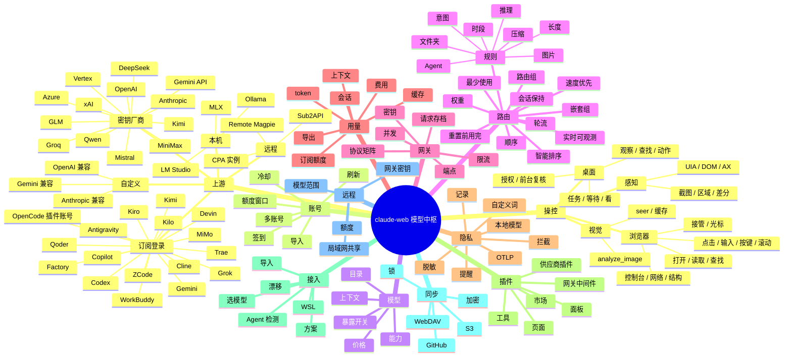

### 3.2 功能对齐矩阵（节选，完整表在实施期逐项打勾）

| # | 能力 | Magpie 参考 | claude-web 目标 | 期 |
|---|---|---|---|---|
| 1 | OpenAI Chat 端点 | `/v1/chat/completions` | 同 | P1 |
| 2 | OpenAI Responses | `/v1/responses` | 同 | P1 |
| 3 | Anthropic Messages | `/v1/messages`、`count_tokens` | 同 | P1 |
| 4 | Gemini generateContent | `:generateContent`、`:streamGenerateContent` | 同 | P1 |
| 5 | Interactions | CPA translator | 同 | P1 |
| 6 | images / videos / speech | Magpie 图像视频、CPA xAI 媒体 | 同 | P1 |
| 7 | `/v1/ws` | CPA wsrelay | 同 | P1 |
| 8 | 模型目录 | `/v1/models` | 同 + 能力字段 | P1 |
| 9 | 订阅登录 | 6 家起 | 21 家 | P2 |
| 10 | 多账号 | 支持 | 支持 | P2 |
| 11 | 额度窗口 | 5h / 周 / 月 / 积分 | 同 | P2 |
| 12 | 签到 | Trae / Qoder / WorkBuddy / MiniMax | 同 | P2 |
| 13 | 自动路由组 | 同名模型自动成组 | 同 | P3 |
| 14 | 7 种路由方式 | smart/order/rotate/usage/pace/weight/fast | 同 | P3 |
| 15 | 5 种会话保持 | auto/session/turn/off/strict | 同 | P3 |
| 16 | 规则 | 9 类条件 | 同 | P3 |
| 17 | 意图路由 | 小模型判编号 | 同 | P3 |
| 18 | 嵌套组 | 最多 8 层 | 同 | P3 |
| 19 | 路由可观测 | 实时动画 | 同 | P3 |
| 20 | 请求存档 | 本地 1 GiB / S3 | 同 | P4 |
| 21 | 上下文分析 | 提示词构成 + 评分 | 同 | P4 |
| 22 | 方案 | 保存/应用 | 同 | P8 |
| 23 | 脱敏 | 密钥/PII/自定义词/本地模型 | 同 | P5 |
| 24 | 三档动作 | 遮罩/提醒/拦截 | 同 | P5 |
| 25 | 脱敏记录 | 30 天 | 同 | P5 |
| 26 | OTLP | 请求 span | 同 | P5 |
| 27 | 供应商插件 | OpenCode auth 钩子 | 同 | P7 |
| 28 | 网关中间件 | 请求/回复改写 | 同 | P7 |
| 29 | 页面/面板插件 | slot + 错误边界 | 同 | P7 |
| 30 | 插件市场 | npm / GitHub | 同 | P7 |
| 31 | Agent 接入 | 20+ 适配器 | 同 | P8 |
| 32 | 配置导入 | Claude Code / Codex / Magpie / CPA | 同 | P8 |
| 33 | 同步 | WebDAV / S3 / GitHub | 同 | P9 |
| 34 | 局域网共享 | 网关密钥 + 限额 | 同 | P9 |
| 35 | 远程 Magpie | 作为上游 | 同 | P9 |
| 36 | 托盘 / 菜单栏 | 有 | 有 | P8 |
| 37 | 主题 / 字体 / 色盲 | 有 | 有 | P0 |
| 38 | 手机 | 无 | 有（我们的壳） | P10 |
| 39 | 浏览器操控 | 21 个工具 | 保留 + 补 observe / act / task | P6 |
| 40 | 桌面操控 | 23 个工具（Windows） | 保留 + 补 UIA / task | P6 |
| 41 | UI Automation 树 | 无 | 有 | P6 |
| 42 | 视觉 seer + 缓存 | 无 | 有 | P6 |
| 43 | 授权 / 接管 / 审计 | 授权有 | 补任务审计与接管 | P6 |
| 44 | 多步任务 | `computer_batch` | `computer_task` / `browser_task` | P6 |
| 45 | 结构化观察 | 无 | `computer_observe` / `browser_observe` | P6 |
| 46 | macOS / Linux 操控 | 无 | macOS 第二期、Linux 第三期 | P6 |

---

### 3.3 操控能力全景

| 层 | 现在 | 目标 |
|---|---|---|
| 浏览器操控 | 21 个工具：open / read / find / click / type / key / scroll / hover / drag / select / eval / console / network / snapshot / wait / tabs / viewport / screenshot / computer / ego / search | 增加 `browser_observe` / `browser_act` / `browser_task`；一次调用跑多步 |
| 桌面操控 | 23 个工具：request_access / screenshot / zoom / click / drag / scroll / type / key / hold_key / clipboard / wait / batch | 增加 `computer_observe` / `find` / `act` / `task` / `wait_for` / `look`；UIA 优先 |
| 感知 | 截图 + 区域放大；网页 AX 树 | 桌面 UIA 树；网页 DOM/AX；差分；视觉 seer 兜底 |
| 动作 | SendInput；网页 sendInputEvent | UIA 模式（Invoke / Value / Toggle / Select）→ SendInput 兜底 |
| 安全 | 应用授权闸、前台复核、不点自己、网页 site gate、接管 | 任务级审计、每步预算、接管即停 |
| 视觉 | 无独立 seer | seer 模型 + 图片哈希缓存 + `analyze_image` |

## 4. 信息架构与导航

### 4.1 一级页面

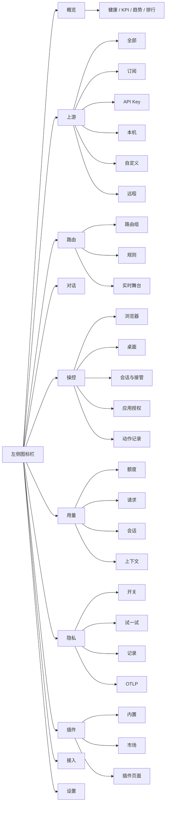

**规则**：一级页面之间不互相嵌套 tab；页面内部的左侧筛选（上游分类）不是导航，不改变页面身份。

### 4.2 全局外壳

```text
┌────────────────────────────────────────────────────────────────────────────┐
│ ● ● ●   claude-web                                    ⌘K    −   □   ×     │ 标题栏
├────┬───────────────────────────────────────────────────────────────────────┤
│    │  概览                                          [状态]  [刷新]  [⋯]     │ 页头
│  ◉ │                                                                       │
│  ▤ │  ┌──────────────┐ ┌──────────────┐ ┌──────────────┐ ┌──────────────┐ │
│  ⇄ │  │ 总请求       │ │ 今日         │ │ 成功率       │ │ 平均延迟     │ │
│  ▥ │  │ 136,214      │ │ 704          │ │ 100.0%       │ │ 196ms        │ │
│  ◔ │  └──────────────┘ └──────────────┘ └──────────────┘ └──────────────┘ │
│  ⚿ │                                                                       │
│  ✦ │  ┌───────────────────────────────────────┐ ┌────────────────────────┐ │
│    │  │ 最近请求                              │ │ 今日趋势               │ │
│    │  │  ▁▂▃▅▇▆▅▃▂▁                          │ │ 6 张小卡 + sparkline   │ │
│    │  └───────────────────────────────────────┘ └────────────────────────┘ │
│    │                                                                       │
│    │  ┌───────────────────────────────────────┐ ┌────────────────────────┐ │
│    │  │ 网关请求（最近 300 秒）               │ │ 网关情报               │ │
│    │  └───────────────────────────────────────┘ └────────────────────────┘ │
│    │                                                                       │
│    │  ┌───────────────────────────────────────────────────────────────────┐ │
│    │  │ 模型排行                                                          │ │
│    │  └───────────────────────────────────────────────────────────────────┘ │
├────┴───────────────────────────────────────────────────────────────────────┤
│ 上游 19 个 · 可用     对话 3        API 密钥 6        v2026.10.27          │ 状态条
└────────────────────────────────────────────────────────────────────────────┘
```

- 左侧图标栏 56px；hover 显示名称；当前页用 2px 左侧短条 + 实心图标，不用大面积高亮。
- 页头只放：页面名、状态、主操作、更多菜单。
- 状态条常驻：上游可用数、正在跑的对话、API 密钥数、版本。
- 左侧图标栏新增「操控」；有正在跑的操控任务时，图标上带一个小绿点。

### 4.3 响应式

| 宽度 | 行为 |
|---|---|
| ≥ 1280 | 完整三栏（rail + 内容 + 可收起的右侧详情） |
| 1024–1279 | 右侧详情改为抽屉 |
| 768–1023 | rail 收成 48px，只显示图标 |
| < 768（手机） | rail 变底部 5 个主入口，其余进「更多」；卡片单列；图表高度减半 |

---

## 5. 视觉系统

### 5.1 令牌

| 类别 | Light | Dark | 用途 |
|---|---|---|---|
| 背景 | `#F6F7F8` | `#0B0C0E` | 页面底 |
| 卡片 | `#FFFFFF` | `#141619` | 卡片、弹层 |
| 卡片次层 | `#FAFAFB` | `#1A1D21` | 卡片内分区 |
| 文字 | `#17181A` | `#F2F3F5` | 主文字 |
| 次文字 | `#8A8F98` | `#9BA1AA` | 标签、说明 |
| 分隔线 | `#ECEDEF` | `#24272C` | 1px 发丝边 |
| 强调 | `#22C55E` | `#34D399` | 健康、主按钮 |
| 强调浅底 | `#E9F8EF` | `#0F2A1D` | 状态 chip |
| 警告 | `#F59E0B` | `#FBBF24` | 提醒、冷却 |
| 危险 | `#EF4444` | `#F87171` | 错误、拦截 |
| 信息 | `#3B82F6` | `#60A5FA` | 链接、选中 |
| 图表 1–7 | `#16A34A #3B82F6 #F59E0B #8B5CF6 #EC4899 #14B8A6 #64748B` | 同色提亮 | 多序列 |

- 圆角：卡片 16px，按钮 10px，输入 10px，chip 999px。
- 阴影：`0 1px 2px rgba(16,24,40,.04), 0 1px 3px rgba(16,24,40,.06)`；hover 提升一档。
- 间距：4 / 8 / 12 / 16 / 24 / 32。
- 字号：11 / 12 / 13 / 14 / 16 / 20 / 28 / 36；数字用 tabular-nums。
- 字体：界面跟随系统（macOS SF / Windows Segoe UI / Linux 系统）；数字可选等宽。
- 色盲模式：切换 Okabe–Ito 七色，图表线型同时变化（实线/虚线/点线），不只靠颜色。

### 5.2 组件清单

| 组件 | 说明 |
|---|---|
| `StatusDot` | 绿/黄/红/灰 + 文案；灰 = 未知，不假装健康 |
| `KpiCard` | 大数字 + 单位 + 副文案 + 可选 sparkline |
| `TrendCard` | 标题 + 大数字 + 变化百分比 + 迷你面积图；绿色=好，红色=坏 |
| `ProviderCard` | 图标 + 名称 + 类型 chip + 账号数 + 额度条 + 状态 |
| `AccountRow` | 账号名 + 套餐 + 窗口条 + 重置时间 + 操作 |
| `ModelRow` | 模型名 + 能力图标 + 上下文 + 价格 + 暴露开关 |
| `QuotaBar` | 已用/总量 + 重置倒计时；>90% 变琥珀 |
| `RouteStage` | 请求点 + 组 + 成员 + 连线；实时飞行动画 |
| `RuleRow` | 条件 chip + → 模型 + 顺序 + ⋯ 菜单 |
| `RequestRow` | 时间 + Agent + 模型 + 状态 + 延迟 + 盾牌徽标 |
| `MaskBadge` | 盾牌 + 遮掉的数量；hover 显示类型 |
| `PluginCard` | 图标 + 名称 + 版本 + 开关 + 页面入口 |
| `EmptyState` | 一句解释 + 一个主操作 + 一个文档链接 |
| `Sheet` | 右侧抽屉，宽度 480；Esc 关闭；焦点回到触发点 |
| `LiveMenu` | 勾选即生效、菜单不关（筛选类） |
| `ErrorBoundary` | 「这个页面停止工作了」+ 原因 + 重试；只影响当前页 |
| `LiveView` | 桌面截图 / 浏览器画面 + Agent 光标 + 涟漪；接管时变成用户可点的画面 |
| `StepTimeline` | 一次 computer_task 的每一步：动作、目标、结果、耗时 |
| `GrantCard` | 应用授权：应用列表、理由、还会做什么（剪贴板 / 系统键） |
| `TakeoverButton` | 接管 / 交还；接管后正在跑的任务立刻停 |
| `ModeSwitch` | 浏览器 / 桌面两种操控模式 |
| `VisionBadge` | 这一步用了视觉兜底 / 缓存命中 |

### 5.3 动效

- 页面切换 160ms ease-out；卡片 hover 120ms。
- 路由动画：请求点沿连线飞行 600ms；同一轮的工具往返用同一条尾迹。
- 数字变化：滚动 400ms；不跳变。
- 尊重 `prefers-reduced-motion`：关闭飞行动画，改为高亮闪一次。

---

## 6. 页面规格

### 6.1 概览

```text
页头：概览        [● 网关运行中] [v2026.10.27] [刷新] [⋯]

┌ 总请求 ────────┐ ┌ 今日 ──────────┐ ┌ 成功率 ────────┐ ┌ 平均延迟 ──────┐
│ 136,214        │ │ 704            │ │ 100.0%         │ │ 196ms          │
│ 全部时间       │ │ 今日           │ │ 今日           │ │ 今日           │
└────────────────┘ └────────────────┘ └────────────────┘ └────────────────┘

┌ 最近请求 ──────────────────────────────┐ ┌ 今日趋势 ──────────────────────┐
│  [总请求] [失败]        [近30天 ▾]     │ │ 请求 704 ↑221.8%   成功率 100% │
│  ▁▂▃▅▇▆▅▃▂▁▂▃▅▇                       │ │ 缓存 0.1%         延迟 196ms  │
│                                        │ │ Token 108.5万     错误 0      │
│ ┌ 今日用量 ──────────────────────────┐ │ └────────────────────────────────┘
│ │ 31.8万 tokens · $2.73              │ │ ┌ 网关情报 ──────────────────────┐
│ └────────────────────────────────────┘ │ │ 本机 API    ● 运行中 :8188     │
└────────────────────────────────────────┘ │ 网关 API    ● 运行中 :1234     │
                                           │ 内置插件 14 · 本地账号 1       │
┌ 网关请求（最近 300 秒） ────────────────┐ │ 运行时 Node 24 · PID 21007     │
│ 2xx 600 · 4xx 0 · 5xx 0 · 总计 704     │ └────────────────────────────────┘
│ 峰值 250 req/min                       │
│ ▁▂▃▅▇▆▅▃▂▁▂▃▅▇                        │
└────────────────────────────────────────┘

┌ 模型排行 ───────────────────────────────────────────────────────────────────┐
│ MODEL                    TOKENS        %          BAR                       │
│ Claude Opus 4.7          704           100.0%     █                          │
│ GPT-5.5 Codex            0             0.0%       ·                          │
└────────────────────────────────────────────────────────────────────────────┘
```

- 数据每 5 秒刷新；右上角「刷新」立即拉一次。
- 所有图表 hover 显示时间点 + 数值；图例可点隐藏序列。
- 「网关情报」每行可点：API 打开设置 → 网络；插件打开插件页；账号打开上游页。
- 空状态：没有任何上游时，概览只显示一张「先添加一个上游」的引导卡，不显示空图表。

### 6.2 上游（A+B）

```text
页头：上游         [+ 添加上游]  [导入…]  [刷新全部]

┌ 左侧筛选 200px ─┐ ┌ 卡片区 ──────────────────────────────────────────────┐
│ 全部 19         │ │ ┌ Codex ─────────┐ ┌ Gemini ────────┐ ┌ Kimi ────────┐ │
│ 订阅 8          │ │ │ ● 2 个账号      │ │ ● 已登录        │ │ ○ 未登录     │ │
│ API Key 6       │ │ │ 5h 62% · 周 31% │ │ 周 12%          │ │              │ │
│ 本机 2          │ │ └─────────────────┘ └─────────────────┘ └──────────────┘ │
│ 自定义 2        │ │ ┌ DeepSeek ───────┐ ┌ Ollama ────────┐ ┌ 远程 office ─┐ │
│ 远程 1          │ │ │ ● 可用          │ │ ● 3 个模型      │ │ ● 连接正常   │ │
│                 │ │ └─────────────────┘ └─────────────────┘ └──────────────┘ │
│ [+ 新建分类]    │ │                                                       │
└─────────────────┘ └───────────────────────────────────────────────────────┘
```

**卡片anatomy**（从上到下）：
1. 28px 图标 + 名称 + 类型 chip（订阅 / Key / 本机 / 自定义 / 远程）。
2. 状态行：`● 2 个账号 · 今天 704 次调用`。
3. 额度条：多窗口时显示最紧的一条，hover 展开全部。
4. 模型数 + 最近一次健康检查时间。
5. hover 右上角出现 `⋯`：刷新、编辑、停用、移除。

**交互规则**：
- 选中卡片：`border: 1px solid var(--accent)` + 阴影提升；**不加左侧高亮条**。
- 单击打开详情抽屉；双击进入「模型」子视图。
- 左侧筛选是单选；切换不重置滚动位置（记住每类的位置）。
- 「添加上游」打开向导（见 6.3）。
- 拖拽卡片可排序；顺序影响「全部」视图和默认路由优先级。

### 6.3 添加上游向导

```text
┌ 添加上游 ────────────────────────────────────────────────┐
│  ① 选择方式                                              │
│  ┌────────────┐ ┌────────────┐ ┌────────────┐ ┌────────┐ │
│  │ 订阅登录   │ │ API Key    │ │ 本机       │ │ 自定义 │ │
│  │ 6 家       │ │ 12 家      │ │ Ollama 等  │ │ URL    │ │
│  └────────────┘ └────────────┘ └────────────┘ └────────┘ │
│  ┌────────────┐ ┌────────────┐                          │
│  │ 远程       │ │ 导入…      │                          │
│  └────────────┘ └────────────┘                          │
│                                                          │
│  ② 选择厂商（以「订阅登录」为例）                        │
│  [Codex] [Gemini] [Antigravity] [Kimi] [Grok] [Devin]   │
│  [Copilot] [Kiro] [Cline] [Qoder] [Trae] [WorkBuddy]    │
│  [ZCode] [Factory] [Kilo] [MiMo] [OpenCode] [更多…]     │
│                                                          │
│  ③ 登录 / 填密钥                                          │
│  ┌ 浏览器登录 ─────────────────────────────────────────┐ │
│  │ 已打开厂商登录页。完成后这里会自动出现账号。        │ │
│  │ [重新打开]  [我有验证码]                             │ │
│  └─────────────────────────────────────────────────────┘ │
│                                                          │
│  [上一步]                                   [取消] [完成] │
└──────────────────────────────────────────────────────────┘
```

四种登录形态（按厂商自动选择，用户不用懂）：
- **回环 OAuth**：本地起 127.0.0.1 随机端口，浏览器登录后回调。
- **设备码**：显示 `ABCD-EFGH`，用户在厂商页面输入（Copilot、Kiro、ZCode）。
- **粘贴令牌**：用户从浏览器复制 token 或 cookie。
- **本机凭证**：读取已安装 IDE / CLI 的登录态（Cursor、Zed、Trae、Qoder）。
- **签到型**：登录后每天一次签到领额度（Trae、Qoder、WorkBuddy、MiniMax）。

### 6.4 账号详情

```text
┌ Codex · work@example.com ──────────────────────── [⋯] ─┐
│ ● 活跃         套餐 Plus          上次检查 12 秒前      │
│                                                         │
│ 5 小时窗口   ███████░░░  62%    2 小时 18 分后重置      │
│ 周窗口       ███░░░░░░░  31%    3 天 4 小时后重置       │
│ 积分         12,400 / 20,000                            │
│                                                         │
│ [立即刷新] [设为默认] [重新登录] [停用]                  │
│                                                         │
│ 最近调用：今天 704 次 · 失败 0 · 平均 196ms             │
└─────────────────────────────────────────────────────────┘
```

- 所有窗口都显示「已用 % + 重置倒计时」；没有数据的窗口显示「未知」，不画 0%。
- 签到型账号显示「今天已签到 / 签到」按钮；失败只 toast，不影响主流程。
- 同一账号在多个来源出现时，显示「这个账号也在 Codex 里登录」的提示。

### 6.5 路由

```text
页头：路由        [新建组]  [刷新额度]

┌ 路由组 ────────────────┐ ┌ 实时舞台 ────────────────────────────────────┐
│ ● Coder      智能      │ │   Agent ──▶ [Coder] ──▶ ┌ Kimi ─────────┐   │
│   Fast       顺序      │ │                         │ ● 正在回答   │   │
│   Opus anywhere 权重   │ │                         └──────────────┘   │
│   auto/claude-opus     │ │                         ┌ DeepSeek ────┐   │
│                        │ │                         │ ○ 备用       │   │
│ [+ 新建组]             │ │                         └──────────────┘   │
└────────────────────────┘ └──────────────────────────────────────────────┘

┌ 规则（Coder） ─────────────────────────────────────────────────────────┐
│ 1  tokens ≥ 150k                        → kimi/kimi-k2.5              │
│ 2  意图「一个简单问题」                  → deepseek/deepseek-v4-flash   │
│ 3  意图「写或修测试」                    → deepseek/deepseek-v4-pro     │
│ 4  压缩上下文                            → deepseek/deepseek-v4-flash   │
│ 5  文件夹 ~/work/acme                    → claude/claude-opus-5-5       │
│ [+ 添加规则]                                     意图判断模型 [Groq ▾]  │
└─────────────────────────────────────────────────────────────────────────┘
```

- 左侧组列表选中态：同样是描边，不用左侧高亮条。
- 舞台实时显示「谁在回答、谁是备用、谁在冷却」；请求点沿连线飞。
- 点任意一条历史请求，舞台回放当时的决策；顶部显示「第 N 轮 · 规则 R 命中 · 判断模型 323ms」。
- 规则编辑器：条件 chip 可叠加；`⋯` 菜单有「设定推理强度」「暂停该模型」「复制」「删除」。
- 意图规则旁显示判断模型、超时（8s）、10 分钟缓存提示。
- 组嵌套：显示层级缩进；超过 8 层拒绝并解释。

### 6.6 对话

保留现有对话页，增加三处与网关的连接：
- 会话头显示「本轮模型：provider/model · 路由组」；hover 看决策原因。
- 消息操作里增加「查看这一轮的上下文构成」。
- 右侧抽屉「路由」显示该会话每一轮的模型、账号、耗时、脱敏数量。

### 6.7 操控

```text
页头：操控        [浏览器] [桌面]        [停止] [打开对话]

┌ 会话 ─────────────────┐ ┌ 实时画面 ──────────────────────────────┐ ┌ 授权与步骤 ────────────┐
│ ● Claude Code         │ │                                        │ │ 已授权                 │
│   桌面 · 记事本        │ │        [ 实时截图 / 浏览器画面 ]        │ │  Notepad               │
│   14:32 · 运行中       │ │        Agent 光标 · 涟漪               │ │  File Explorer         │
│                       │ │                                        │ │                        │
│ ○ Codex               │ │                                        │ │ 步骤 2 / 5             │
│   浏览器 · 表单        │ │                                        │ │  1 打开记事本      ✓   │
│   14:28 · 等待授权     │ │                                        │ │  2 输入文本        …   │
│                       │ │                                        │ │  3 保存            ·   │
│                       │ │                                        │ │ [接管] [停止]          │
└───────────────────────┘ └────────────────────────────────────────┘ └────────────────────────┘

┌ 最近动作 ───────────────────────────────────────────────────────────────────────────────┐
│ 14:32:04  输入文本      记事本 · 编辑区        ✓ 120 字        18ms                     │
│ 14:32:03  Invoke        记事本 · 保存按钮      ✓               6ms                      │
│ 14:32:02  observe       记事本 · 窗口          ✓ 42 个控件      84ms                     │
└──────────────────────────────────────────────────────────────────────────────────────────┘
```

**用途**：看正在跑的操控任务、批应用授权、接管、回放动作。不是聊天页，也不是权限卡本身。

**布局**
- 左：会话列表。每行 = 对话名 + 模式（浏览器 / 桌面）+ 当前应用 / 标签 + 状态（运行中 / 等待授权 / 已暂停 / 已接管 / 出错）。
- 中：实时画面。桌面模式是截图 + Agent 光标；浏览器模式是当前标签的画面。顶部一条状态：第几步、当前动作、耗时。
- 右：本会话的授权应用列表、步骤时间线、当前步骤的结果；底部「接管 / 停止」。
- 下：最近动作审计（时间、动作、目标、结果、耗时）。点一行看详情（ref、坐标、前后截图）。

**状态**
- 没有任务：一句「还没有正在跑的操控任务」+「在对话里打开操控电脑，或让 Agent 使用浏览器」。
- 等待授权：中间显示授权卡（应用列表 + 理由），两侧变暗；允许后继续。
- 已接管：中间画面变成用户可操作；Agent 的所有输入被拒；顶部「交还」。
- 出错：中间保留最后一帧，右侧写原因（控件找不到 / 前台变了 / 应用没授权）。

**交互**
- 模式切换是分段控件，不是二级 tab；切换只影响当前会话的视图，不改变页面。
- 点会话切换焦点；双击打开对应对话。
- 「接管」立刻中止正在跑的任务（含拖到一半的拖动）；「交还」后 Agent 可以继续。
- 桌面模式可以点「只看这个窗口」缩到目标窗口；浏览器模式可以切标签 / 视口（复用现有浏览器面板）。
- 手机：只读实时画面 + 接管 / 停止；不能发起新的操控任务。

### 6.8 用量

```text
页头：用量        [今天] [7 天] [30 天] [全部]        [导出]

┌ 订阅额度 ──────────────────────────────────────────────────────────────┐
│ Codex · work   5h 62% · 周 31%     Claude · me   5h 40% · 周 12%       │
│ Copilot · pro  月 8%               WorkBuddy     积分 12,400           │
└────────────────────────────────────────────────────────────────────────┘

┌ Token / 费用 ──────────────────────────────────┐ ┌ 按 Agent ──────────┐
│  总 Token 108.5万  缓存 0.1%  $2.73            │ │ Claude Code  62%   │
│  ▁▂▃▅▇▆▅▃▂▁                                    │ │ Codex        31%   │
└────────────────────────────────────────────────┘ │ 其它          7%   │
                                                   └────────────────────┘

[请求] [会话] [上下文]
┌ 请求 ──────────────────────────────────────────────────────────────────┐
│ 时间   Agent       模型                  Token   费用   延迟   状态    │
│ 14:32  Claude Code claude/opus-4.7       12.4k   $0.18  1.2s   200    │
│ 14:31  Codex       codex/gpt-5.5         8.1k    $0.06  0.9s   200    │
└────────────────────────────────────────────────────────────────────────┘
```

- 上下文标签页：每个 Agent 的提示词构成（系统 / 工具 / 指令 / 文件 / 对话）+ 百分制评分 + 标签（「起步轻」「MCP 偏重」）。
- 请求行点开：请求体、回复、路由轨迹、脱敏记录；原文只保留最近 10 次在内存。
- 导出：CSV / JSON；可选择是否包含正文（默认不含）。

### 6.9 隐私

```text
页头：隐私        [全部开启] [全部关闭]

┌ 要遮什么 ──────────────────────────────────────────────────────────────┐
│ 脱敏密钥            [开关]   API Key、私钥、Token、密码、JWT、.env     │
│ 脱敏个人信息        [开关]   邮箱、手机、身份证、银行卡、SSN、护照     │
│   └ 主目录用户名    [开关]                                              │
│   └ 用户名@主机名   [开关]                                              │
│   └ 公网 IP         [开关]                                              │
│ 脱敏词              [输入]   Nightjar, db.acme-corp.cn                  │
│ 自定义规则          [输入]   开头匹配或正则                             │
│ 用本地模型查找      [开关]   AstrLink Guard 39MB / Privacy Filter 1.6GB │
│ 发现敏感值时        [遮罩 ▾]  遮罩 / 提醒 / 拦截                        │
│ 从不脱敏            [输入]   团队邮箱、测试 key                         │
└────────────────────────────────────────────────────────────────────────┘

┌ 试一试 ────────────────────────────────────────────────────────────────┐
│ 输入：Deploy Nightjar with OPENAI_API_KEY=sk-proj-8fK2...              │
│ 厂商收到：Deploy {{TERM_5hmsrhdc}} with OPENAI_API_KEY={{API_KEY_srhj...}}│
│ [试一试]                                                               │
└────────────────────────────────────────────────────────────────────────┘

┌ 脱敏记录（最近 30 天） ────────────────────────────────────────────────┐
│ 类型       次数    最近     Agent         供应商                       │
│ API_KEY    128     14:32    Claude Code   DeepSeek                     │
│ EMAIL      42      14:30    Codex         OpenAI                       │
└────────────────────────────────────────────────────────────────────────┘

┌ OTLP 导出 ─────────────────────────────────────────────────────────────┐
│ 关闭 / 开启    地址 [https://...]   指标 [ ]  正文 [ ]  会话 [ ]       │
└────────────────────────────────────────────────────────────────────────┘
```

- 每个开关旁边有一行「会遮掉什么」的例子；不写抽象术语。
- 改动从下一个请求生效，不用重启；界面明确写这句。
- 关闭脱敏时二次确认，说明「厂商会看到明文」。
- 任何配置错误导致脱敏跑不了：顶部红色横幅「脱敏未生效，请求会被拒绝」，并提供修复入口。

### 6.10 插件

```text
页头：插件        [安装…] [市场]

[内置] [市场] [已安装]
┌ 内置 ──────────────────────────────────────────────────────────────────┐
│ 隐私遮盖 ●   网关日志 ●   用量统计 ●   路由 ●   会话 ●   OTLP ○        │
│ 每个卡片：名称、一句话、开关、设置（schema 自动生成）                   │
└────────────────────────────────────────────────────────────────────────┘

┌ 市场 ──────────────────────────────────────────────────────────────────┐
│ [搜索]  分类：供应商 / 中间件 / 工具 / 页面 / 主题                     │
│ ┌ 卡片 ┐ ┌ 卡片 ┐ ┌ 卡片 ┐                                           │
│ │ 图标 │ │ 图标 │ │ 图标 │   名称、作者、下载量、兼容版本、安装       │
│ └──────┘ └──────┘ └──────┘                                           │
└────────────────────────────────────────────────────────────────────────┘
```

- 插件页面出现在左侧栏「插件」下的子项（由插件注册），打开时走 slot + 错误边界。
- 安装前显示权限：网络域名、文件读写、能改哪些请求；默认最小权限。
- 插件崩溃只影响它自己的页面/中间件，主界面不白屏。

### 6.11 接入（Agents）

```text
页头：接入        [重新扫描] [保存当前为方案]

┌ Agent ─────────────────────────────────────────────────────────────────┐
│ Claude Code   ● 已接入   claude/opus-4.7        [改模型] [断开]        │
│ Codex         ● 已接入   codex/gpt-5.5          [改模型] [断开]        │
│ Gemini CLI    ○ 未安装                                          │
│ OpenCode      ● 已接入   group/coder             [改模型] [断开]        │
└────────────────────────────────────────────────────────────────────────┘

┌ 方案 ──────────────────────────────────────────────────────────────────┐
│ 工作 · 全部用强模型   ✓ 当前        [应用] [编辑] [删除]                │
│ 省钱 · 简单问题走 Flash            [应用] [编辑] [删除]                │
└────────────────────────────────────────────────────────────────────────┘
```

- 每个 Agent 一行：检测状态、当前模型、推理强度、配置文件路径（hover 显示）。
- 「断开」恢复原配置；显示「会还原哪几个键」。
- 检测到配置文件被外部改动时显示「漂移」标记，可一键重新同步。
- 导入：Claude Code `settings.json`、Codex `config.toml`、Magpie `providers.json`、CPA `config.yaml` + `auths/`。

### 6.12 设置

| 分组 | 行 |
|---|---|
| 通用 | 外观、语言、文字大小、色盲模式、开机启动、托盘点击、轻量模式、防止休眠 |
| 网络 | 监听地址、端口、局域网共享、网关密钥、代理 |
| 模型 | 默认推理强度、意图判断超时、上下文窗口覆盖 |
| 隐私 | 计入用户数（默认关）、分享使用统计（默认关）、请求存档 |
| 可观测性 | OTLP 地址、指标、正文、会话 |
| 同步 | WebDAV / S3 / GitHub、加密口令、立即同步、恢复 |
| 关于 | 版本、更新渠道、检查更新、许可证与第三方声明 |

### 6.13 托盘 / 手机 / 命令面板

- 托盘：当前模型、快速切换、暂停网关、打开概览、退出。
- 手机：底部 5 个入口（概览 / 上游 / 路由 / 对话 / 更多）；图表简化；添加上游用全屏向导。
- `⌘K`：命令面板，可搜页面、上游、模型、动作（「添加 Codex 账号」「开启脱敏」「新建路由组」）。

---

## 7. 关键流程

### 7.1 首次启动

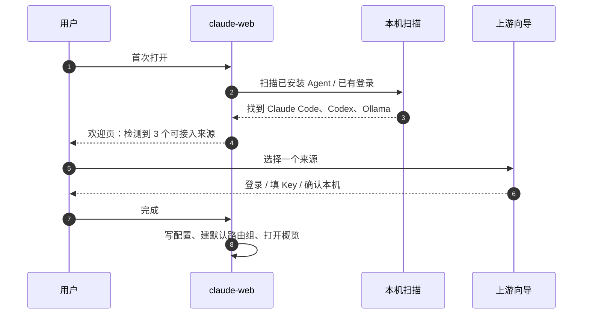

### 7.2 添加订阅账号

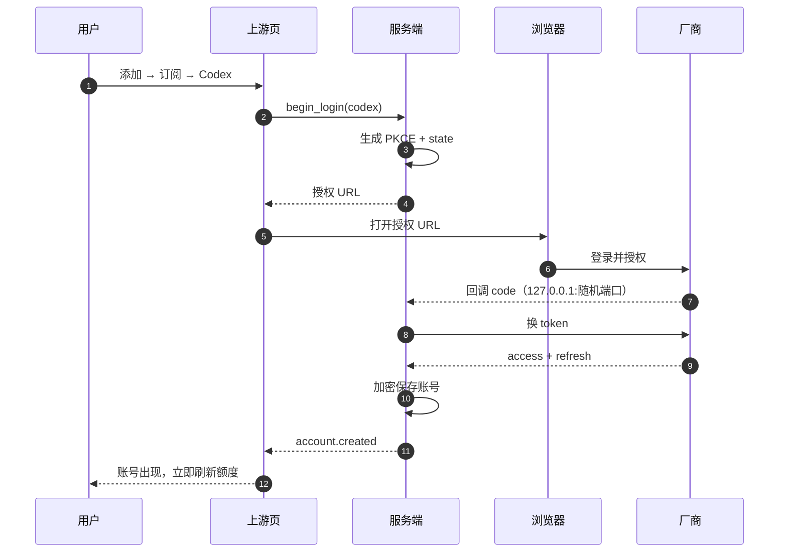

设备码流程把「回调」替换为「显示 code → 轮询 token 端点」；粘贴令牌流程把「换 token」替换为「校验并保存」。

### 7.3 给 Agent 选模型

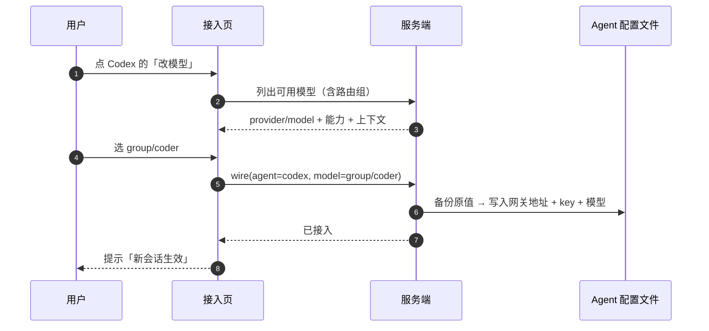

### 7.4 一轮请求

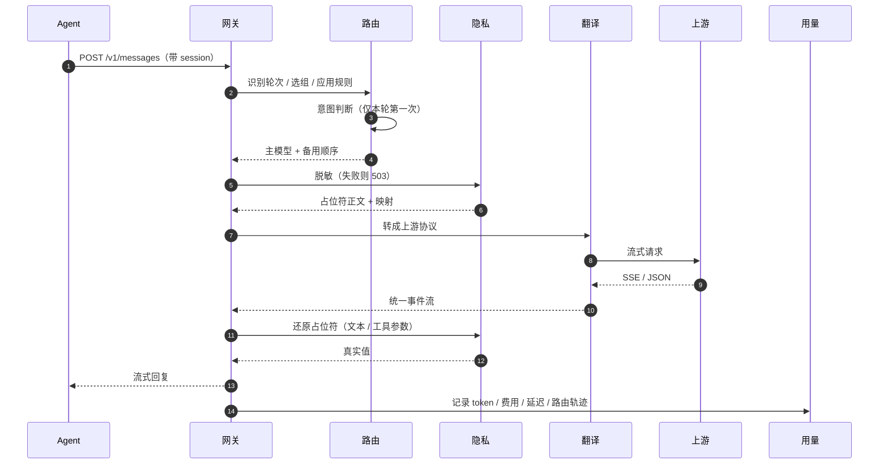

### 7.5 意图路由

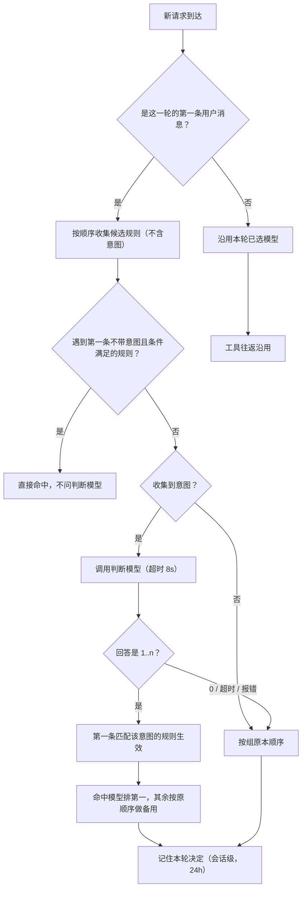

### 7.6 隐私脱敏

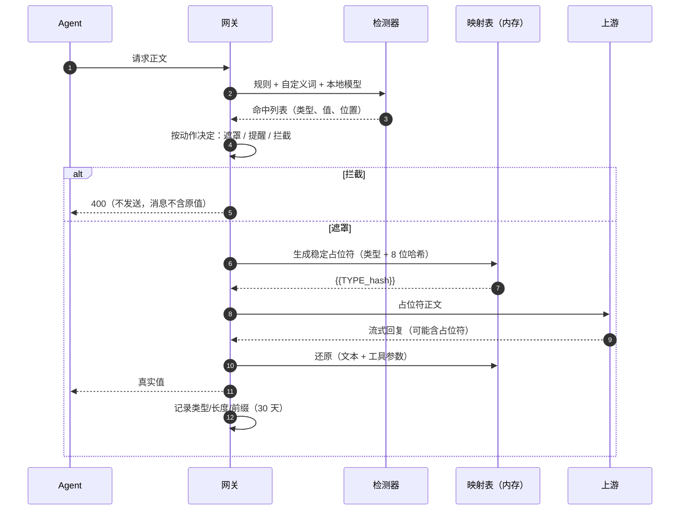

### 7.7 插件安装

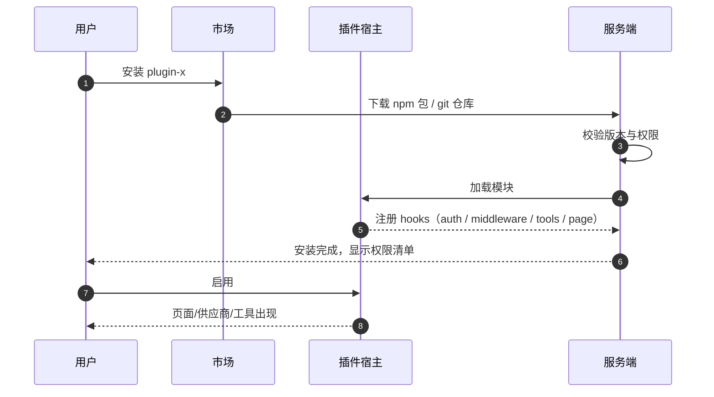

### 7.8 远程共享

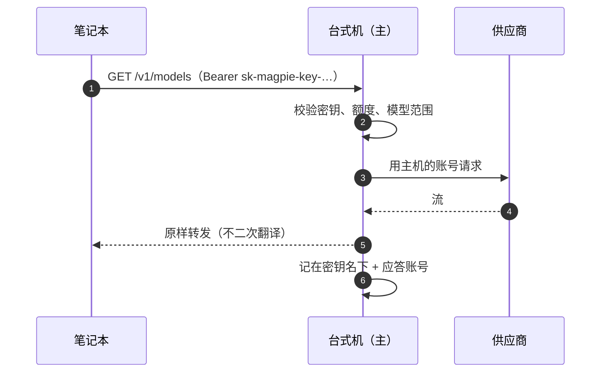

### 7.9 同步 / 恢复

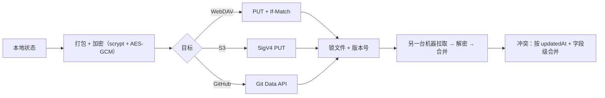

---

### 7.10 一次操控任务

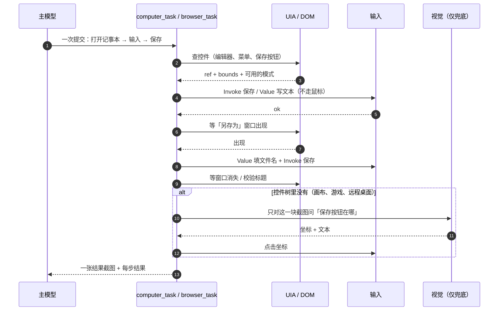

要点：**一次模型往返跑完多步**；步与步之间用 `waitFor` 条件，不回到模型；UIA 能做的绝不看像素；视觉只在控件树缺失时用，并按图片哈希缓存。

### 7.11 授权与接管

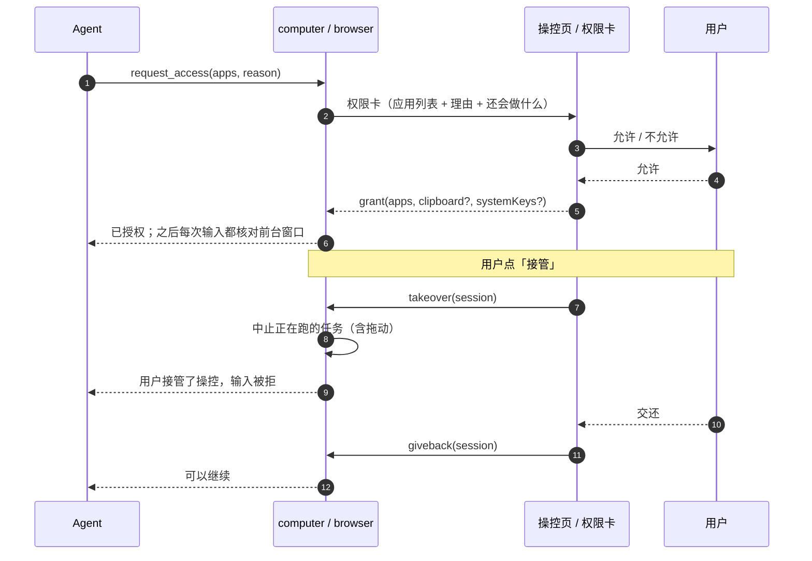

要点：**授权不是对话的权限模式**——「完全放开」也不能绕过应用授权；接管属于对话，不属于某个标签；接管后只允许读。

## 8. 系统架构

### 8.1 系统上下文

```mermaid
flowchart LR
  U["用户"] --> App["claude-web 桌面 / 手机"]
  App --> Agents["本机 Agent · Claude Code / Codex / Gemini CLI / OpenCode …"]
  Agents -->|"OpenAI / Anthropic / Gemini / WS"| GW["本地网关"]
  GW --> Providers["云端供应商"]
  GW --> Local["本机模型 · Ollama / LM Studio / MLX"]
  GW --> Remote["远程 Magpie / CPA 实例"]
  GW --> Plugin["插件宿主"]
  Plugin --> NPM["npm / GitHub"]
  App --> Sync["WebDAV / S3 / GitHub"]
  App --> OTLP["OTLP 收集器"]
  App --> Browser["内置浏览器 / ego lite"]
  App --> Computer["操控 · 浏览器 / 桌面"]
  Computer --> LocalApps["本机应用 / 桌面"]
  Computer --> Vision["视觉 seer"]
```

### 8.2 容器架构

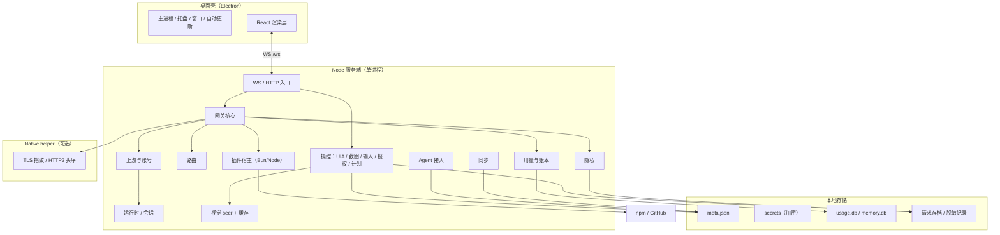

### 8.3 服务端模块

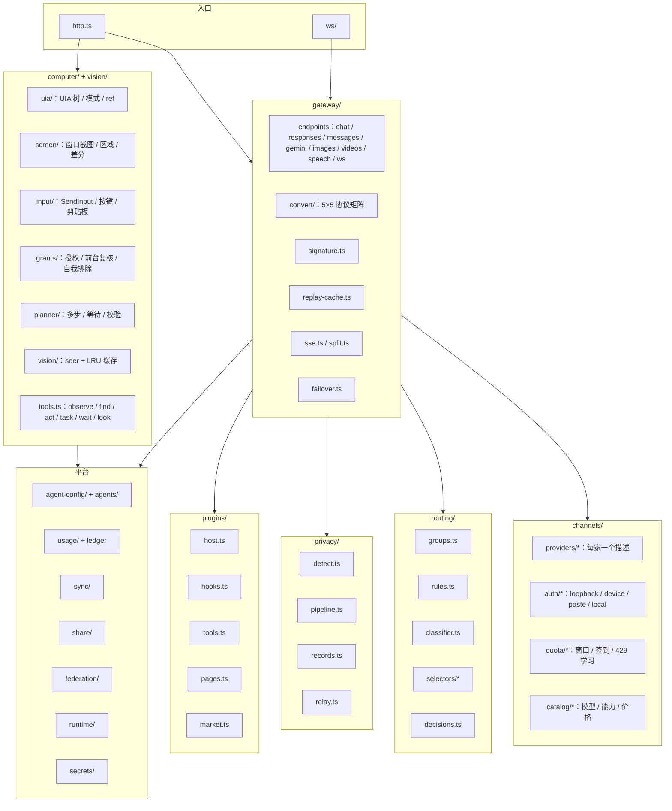

### 8.4 前端模块

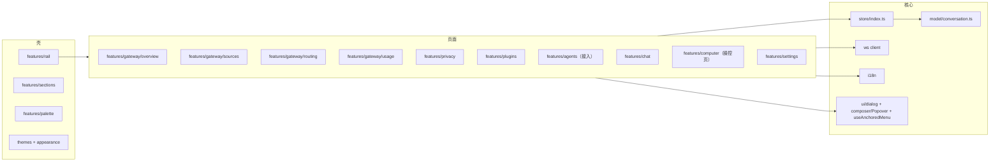

### 8.5 领域模型

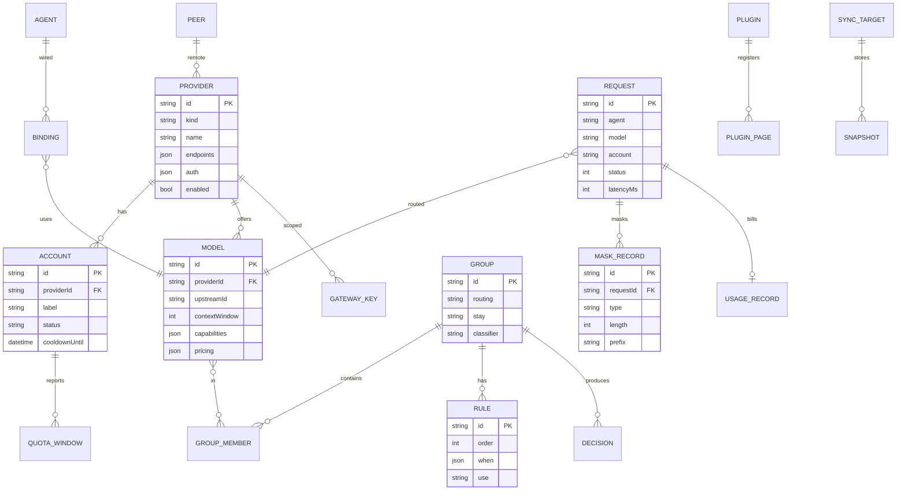

> 操控的实体（会话、授权、动作）见 §8.19 的 ERD。

### 8.6 核心类型

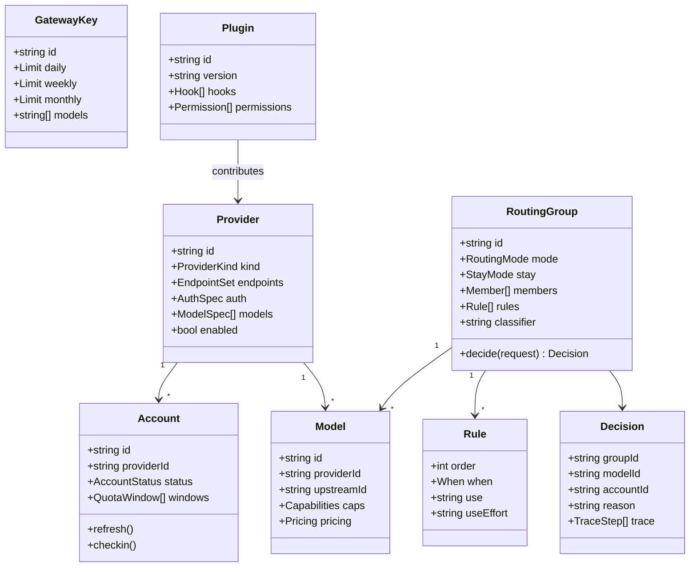

### 8.7 请求生命周期

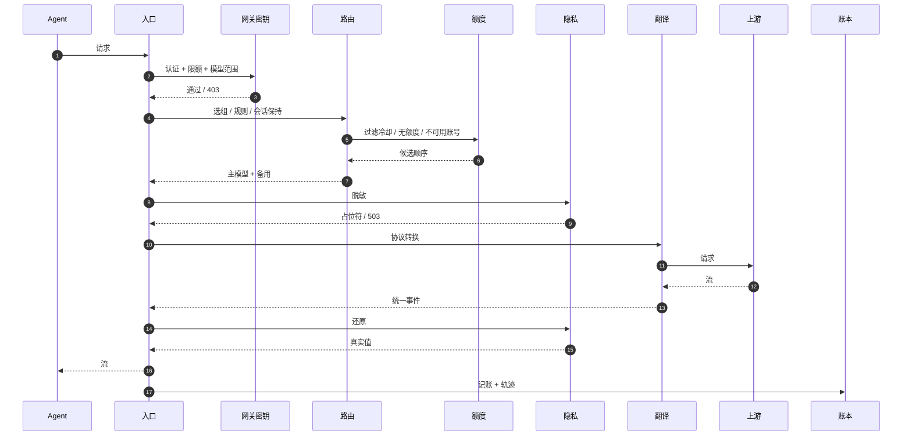

### 8.8 翻译与流式

```mermaid
flowchart LR
  A["入口协议"] --> B["统一 IR"]
  B --> C["目标协议"]
  C --> D["上游"]
  D --> E["上游事件"]
  E --> F["统一事件"]
  F --> G["入口协议事件"]
  G --> H["SSE / JSON / WS"]
  subgraph 细节
    I["签名校验 / 清洗"]
    J["thinking 回放缓存"]
    K["tool call 增量合并"]
    L["usage 归一"]
  end
  B --- I
  F --- J
  F --- K
  F --- L
```

### 8.9 账号状态机

```mermaid
stateDiagram-v2
  [*] --> LoggedOut
  LoggedOut --> LoggingIn: begin_login
  LoggingIn --> Active: token 成功
  LoggingIn --> LoggedOut: 取消 / 失败
  Active --> Refreshing: 距过期少于 5 分钟
  Refreshing --> Active: refresh 成功
  Refreshing --> Expired: refresh 失败
  Active --> Cooling: 429 / 额度耗尽
  Cooling --> Active: 冷却结束 / 重置
  Active --> Expired: 401 / 撤销
  Expired --> LoggingIn: 重新登录
  Active --> Disabled: 用户停用
  Disabled --> Active: 启用
```

### 8.10 路由决策

```mermaid
flowchart TD
  A["请求"] --> B["识别 Agent / 会话 / 轮次"]
  B --> C{"是否新一轮？"}
  C -- 否 --> D["沿用本轮决定"]
  C -- 是 --> E["取组 + 成员 + 规则"]
  E --> F["过滤不可用账号（冷却/额度/模型）"]
  F --> G["按路由方式排序"]
  G --> H["应用规则（从上到下）"]
  H --> I{"规则含意图？"}
  I -- 是 --> J["调用判断模型"]
  J --> K["命中规则模型排第一"]
  I -- 否 --> L["按排序"]
  K --> M["生成 Decision + Trace"]
  L --> M
  M --> N["请求"]
  N --> O{"失败？"}
  O -- 是 --> P["下一个成员（同轮保持接手者）"]
  O -- 否 --> Q["完成"]
  P --> N
```

### 8.11 隐私管线

```mermaid
flowchart LR
  A["请求"] --> B["规则检测"]
  B --> C["自定义词"]
  C --> D["本地模型（可选）"]
  D --> E{"动作"}
  E -- 遮罩 --> F["占位符"]
  E -- 提醒 --> G["原样 + 徽标"]
  E -- 拦截 --> H["400 / 不发送"]
  F --> I["上游"]
  I --> J["回复"]
  J --> K["还原"]
  K --> L["Agent"]
  F --> M["记录（类型/长度/前缀）"]
  G --> M
  H --> M
```

### 8.12 插件运行时

```mermaid
flowchart TB
  subgraph Host["插件宿主"]
    Loader["加载器（npm / git / 文件夹）"]
    Sandbox["沙箱（权限 / 网络 / 文件）"]
    Registry["注册表"]
  end
  subgraph Points["扩展点"]
    AUTH["供应商 auth / models / usage / refresh / checkin"]
    MW["网关中间件（请求 / 回复 / 流）"]
    TOOL["工具（MCP）"]
    PAGE["页面 / 面板（slot）"]
    HOOK["异步请求钩子"]
    BUDGET["预算 / 限流"]
  end
  Loader --> Sandbox --> Registry
  Registry --> AUTH
  Registry --> MW
  Registry --> TOOL
  Registry --> PAGE
  Registry --> HOOK
  Registry --> BUDGET
  MW --> GW["网关"]
  AUTH --> CH["上游"]
  TOOL --> AG["Agent"]
  PAGE --> UI["React 壳"]
```

### 8.13 存储

```mermaid
flowchart LR
  subgraph meta["meta.json"]
    M1["settings"]
    M2["providers（无密钥）"]
    M3["groups / rules"]
    M4["bindings"]
    M5["plugins"]
  end
  subgraph secrets["secrets（加密）"]
    S1["账号 token / refresh"]
    S2["API keys"]
    S3["网关密钥"]
    S4["同步口令"]
  end
  subgraph db["SQLite"]
    D1["usage.db"]
    D2["memory.db"]
    D3["requests（可选）"]
  end
  subgraph files["文件"]
    F1["request-archive/"]
    F2["masking/"]
    F3["backups/"]
    F4["plugins/"]
  end
```

### 8.14 WS 协议

| 事件 | 方向 | 载荷 |
|---|---|---|
| `gateway.status` | S→C | 运行状态、端口、版本、计数 |
| `gateway.metrics` | S→C | KPI、趋势、排行（5s） |
| `provider.list` | C→S | 无 |
| `provider.upsert` / `provider.remove` | C→S | 无密钥的 Provider |
| `account.beginLogin` | C→S | providerId、方式 |
| `account.loginUrl` / `account.deviceCode` | S→C | URL / code |
| `account.created` / `account.updated` | S→C | Account（脱敏） |
| `route.decision` | S→C | Decision + Trace |
| `route.replay` | C→S | requestId |
| `privacy.test` | C→S | 文本 |
| `privacy.result` | S→C | 遮罩后文本 + 命中 |
| `plugin.install` / `plugin.state` | C↔S | id、版本、权限 |
| `usage.query` | C→S | 时间范围、维度 |
| `sync.run` / `sync.state` | C↔S | 目标、进度 |
| `computer.session` | S→C | 会话状态、模式、应用、步骤 |
| `computer.action` | S→C | 动作、目标、结果、耗时 |
| `computer.grant` | C↔S | 应用、剪贴板、系统键 |
| `computer.takeover` | C→S | sessionId、on / off |
| `computer.stop` | C→S | sessionId |

所有带 `sessionId` 的请求必须进 `federation/rewrite.ts` 的路由表。

### 8.15 安全边界

```mermaid
flowchart TB
  subgraph Trust["高信任"]
    UI["渲染层"]
    SRV["服务端"]
    SEC["secrets"]
  end
  subgraph Medium["中信任"]
    PL["插件（沙箱）"]
    NAT["native helper"]
  end
  subgraph Low["低信任"]
    WEB["外部网页（内置浏览器）"]
    AG["Agent 输出"]
    UP["上游响应"]
  end
  UI --> SRV
  SRV --> SEC
  SRV --> PL
  SRV --> NAT
  WEB -->|"site gate / 权限卡"| SRV
  AG -->|"工具权限"| SRV
  UP -->|"解析 / 校验"| SRV
```

- 密钥只在服务端内存与加密存储；渲染层永远拿不到明文。
- 插件默认无网络、无文件；权限在安装时列明。
- 内置浏览器与 Agent 的网页访问走 site gate；完全放开时自动加入允许名单。
- 隐私失败即 503；不允许明文降级。
- 所有日志脱敏；错误消息不回显原值。
- 操控是独立的能力边界：应用授权、前台复核、不点自己、接管即停，都不受对话权限模式影响。
- 屏幕内容和控件名是**数据**，不是指令；模型不能因为截图里写了什么就去执行。
- 授权卡只在「操控页 / 权限卡」出现；总览和 IM 机器人不能批准。

### 8.16 部署形态

```mermaid
flowchart LR
  A["桌面版 · Electron + 服务端 + 托盘"] --> B["本机 Agent"]
  C["无头模式 · serve"] --> B
  D["Docker · NAS / 服务器"] --> E["局域网 / VPN 客户端"]
  E --> C
  F["手机壳"] --> G["远程 / WebRTC"]
  G --> A
```

操控只在本机：远程 / 无头模式不提供桌面控制；浏览器工具需要桌面窗口（`NEEDS_DESKTOP`）。

### 8.17 可观测性

```mermaid
flowchart LR
  GW["网关"] --> L["账本 usage.db"]
  GW --> R["请求记录（内存 10 条 + 存档）"]
  GW --> O["OTLP span"]
  L --> U["用量页"]
  R --> U
  O --> C["Langfuse / 收集器"]
  GW --> T["路由轨迹"]
  T --> RT["路由页"]
  CT["操控"] --> AL["动作审计（时间 / 动作 / 目标 / 结果 / 耗时）"]
  AL --> CTRL["操控页"]
```

### 8.18 失败矩阵

| 情况 | 行为 | 界面 |
|---|---|---|
| 账号 401 | 标记过期，尝试 refresh；失败则换下一个 | 账号红色「需重新登录」 |
| 账号 429 | 冷却，记录 reset 时间；换下一个 | 琥珀「冷却至 14:32」 |
| 上游 5xx | 重试一次，再换下一个 | 请求行红色 + 原因 |
| 所有成员不可用 | 返回 503 + 最后一个错误（脱敏） | 路由页顶部横幅 |
| 脱敏不可用 | 503，不发送 | 隐私页红色横幅 |
| 插件崩溃 | 只影响该插件 | 页面「停止工作」+ 重试 |
| 同步冲突 | 字段级合并，保留两份 | 同步页列出冲突 |
| 远程断开 | 标记 peer 离线，模型保留但置灰 | 上游卡片灰色 |
| 控件树读不到 | 退回截图 + 视觉 seer，结果缓存 | 步骤标「视觉兜底」 |
| 前台窗口变了 | 不发任何输入，报「changed」 | 步骤失败 + 原因 |
| 应用没授权 | 拒绝输入，提示先 request_access | 授权卡 |
| 用户接管 | 中止当前任务（含拖动） | 操控页显示「已接管」 |
| 截图失败 | 报错并保留上一帧 | 操控页保留最后一帧 |
| 多显示器 / DPI | 只截主屏；坐标按真实像素换算 | 设置里写明 |

### 8.19 操控运行时

**一句话**：桌面走 UI Automation，网页走 DOM/AX；一次调用跑多步；截图和视觉只做兜底。

```mermaid
flowchart TB
  subgraph Tools["MCP 工具"]
    C["computer_observe / find / act / task / wait / look"]
    B["browser_observe / act / task"]
  end
  subgraph Desktop["桌面（Windows 先行）"]
    U["uia：UIA 树、模式、ref"]
    S["screen：窗口截图、区域、差分"]
    I["input：SendInput、按键、剪贴板"]
    G["grants：授权、前台复核、自我排除"]
    P["planner：多步、等待、校验"]
  end
  subgraph Browser["浏览器"]
    CDP["CDP：AX 树、ref、console / network"]
  end
  V["vision：seer 模型 + LRU 缓存"]
  C --> U
  C --> S
  C --> I
  C --> G
  C --> P
  C --> V
  B --> CDP
  S --> V
```

```mermaid
erDiagram
  COMPUTER_SESSION ||--o{ ACTION : logs
  COMPUTER_SESSION ||--o{ GRANT : grants
  GRANT }o--|| APP : targets
  COMPUTER_SESSION {
    string id PK
    string conversationId
    string mode
    string app
    string status
    datetime startedAt
  }
  GRANT {
    string id PK
    string sessionId FK
    string appName
    bool clipboardRead
    bool clipboardWrite
    bool systemKeyCombos
  }
  ACTION {
    string id PK
    string sessionId FK
    string kind
    string target
    string result
    int latencyMs
    datetime at
  }
  APP {
    string name PK
    string proc
    string exe
  }
```

| 模块 | 职责 |
|---|---|
| `computer/uia` | UIA 树、模式（Invoke / Value / Toggle / Select / Expand）、ref 编号、按名字找控件 |
| `computer/screen` | 窗口级截图、区域放大、差分、JPEG/WebP、尺寸与 DPI |
| `computer/input` | 现有 helper：SendInput、按键、剪贴板 |
| `computer/grants` | 现有授权：应用、前台复核、自我排除、剪贴板 / 系统键 |
| `computer/planner` | 多步计划、条件等待、结果校验、预算 |
| `computer/tools` | 对外工具：observe / find / act / task / wait / look + 现有 23 个 |
| `vision` | seer 模型选择、调用、超时、按图片 sha256 的 LRU |
| `web/observe` | AX 树 + ref + 截图 + 控制台 / 网络摘要 |
| `web/task` | 多步浏览器计划 |

**新增工具**

| 工具 | 只读 | 作用 |
|---|---|---|
| `computer_observe` | 是 | 前台应用 / 窗口、UIA 树（可操作元素 + ref）、截图、与上次的差异 |
| `computer_find` | 是 | 按角色 / 名字 / 文本 / 窗口查控件，返回 ref 和坐标 |
| `computer_act` | 否 | 按 ref 或坐标动作；UIA 模式优先，SendInput 兜底 |
| `computer_task` | 否 | 一次提交多步 `steps[]`，每步可带 `waitFor`；本地执行，回一张结果截图 |
| `computer_wait_for` | 是 | 等文本 / ref / 控件消失 / 窗口出现；UIA 轮询 |
| `computer_look` | 是 | 指定区域 + 问题，交给 seer；按图片哈希缓存 |
| `browser_observe` | 是 | AX 树 + ref + 截图 + 控制台 / 网络摘要 |
| `browser_act` | 否 | 按 ref 操作，或 `eval` 一段脚本 |
| `browser_task` | 否 | 多步浏览器计划（打开 → 填表 → 提交 → 等文本） |

保留现有低层工具（`screenshot` / `left_click` / `type` / `key` / `batch` …）作为兜底和调试。

**速度工程**
1. 结构优先：桌面 UIA、网页 DOM/AX；能按名字拿到的控件绝不看像素。
2. 窗口级截图：只截目标窗口；JPEG/WebP；长边 ≤1568；小字用区域放大。
3. 差分：`observe` 只回变化的子树和新截图。
4. 批量：`computer_task` / `browser_task` 本地跑多步，步间用 `waitFor`，不回到模型。
5. 常驻与预热：helper 常驻；预热应用、缓存窗口树、异步截图。
6. 视觉缓存：`look` / `analyze_image` 按图片 sha256 缓存；同一屏第二次几乎零成本。
7. 小模型做 seer：描述截图用快的小视觉模型或本地模型，不用主推理模型。
8. 结果不重复传图：图片工具 `alwaysLoad`；结果带图片 + ref，避免 ccb 的 `ExecuteExtraTool` 把图变成 base64 文本。
9. 预算：每步 < 5 s，每个任务有总预算；接管即中止。

**安全**
- 授权闸不动：`request_access` 列应用 + 理由；没批过不截图、不发输入。
- 前台复核：发输入那一刻再核对前台窗口和坐标下的窗口。
- 永远不点自己：桌面版按 exe、网页版按标题。
- 剪贴板 / 系统键：只有授权卡上写了才做。
- 任务级审计：每步记录动作、ref、结果、耗时；截图可选保存。
- 接管：用户点「接管」后正在跑的任务立刻停；只允许读。

**跨平台**

| 平台 | 感知 | 动作 | 状态 |
|---|---|---|---|
| Windows | UI Automation（`UIAutomationClient`，PowerShell / C# helper 加载） | SendInput（已有）+ UIA 模式 | 先做 |
| macOS | AXUIElement（辅助功能树） | CGEvent | 第二期 |
| Linux | AT-SPI | xdotool / ydotool（Wayland 受限） | 第三期 |
| 浏览器 | CDP（跨平台） | `sendInputEvent` / `eval` | 已有 |

> 不直接用 Claude Code 自带的 computer use：它 macOS 优先，我们的引擎里那个服务器是空壳，`computer-use` 名字还被保留（之前实测过）。我们自己的 `computer` 更可控，也能跨平台。

---

## 9. 与现有代码的映射

| 现有模块 | 去向 |
|---|---|
| `server/src/gateway/*` | 扩成 `gateway/endpoints/*` + `convert/*` + `signature.ts` + `replay-cache.ts` |
| `server/src/upstreams/*` | 保留 sidecar（Gemini 网页 / WorkBuddy），其余并入 `channels/` |
| `server/src/channels/*` | 扩成 `providers/` + `auth/` + `quota/` + `catalog/` |
| `server/src/routing/*` | 扩成 `groups/` + `rules/` + `classifier/` + `selectors/` |
| `server/src/privacy/*` | 扩成 `detect/` + `pipeline/` + `records/` + `relay/` |
| `server/src/plugins/*` | 扩成 `host/` + `hooks/` + `tools/` + `pages/` + `market/` |
| `server/src/sync/*` | 增加 WebDAV / S3 / GitHub 后端 |
| `server/src/share/*` | 网关密钥 + 限额 + 模型范围 |
| `server/src/federation/*` | 远程 Magpie / CPA 实例 |
| `server/src/engines/*` | 删除「下载 CPA / Magpie 二进制」路径；只保留自有引擎 |
| `web/src/features/gateway/*` | 拆成 `overview/` `sources/` `routing/` `usage/` |
| `web/src/features/privacy/*` | 扩成完整隐私页 |
| `web/src/features/plugins/*` | 增加市场与插件页面 slot |
| `web/src/features/agents`（新） | 接入页 |
| `web/src/features/rail/*` | 增加「模型」分组入口 |
| `server/src/computer/*` | 拆成 `uia/` + `screen/` + `input/` + `grants/` + `planner/` + `tools`；现有 23 个工具保留 |
| `server/src/vision/*`（新） | seer 模型 + 图片哈希缓存 + `analyze_image` |
| `server/src/web/*` | 增加 `observe.ts` + `task.ts`；现有 21 个浏览器工具保留 |
| `web/src/features/computer/*` | 扩成「操控」页：会话、实时画面、授权、步骤时间线、接管 |
| `web/src/features/browser/*` | 现有浏览器面板 + `browser_observe/act/task` |

---

## 10. 实施计划

### 10.1 依赖关系

```mermaid
flowchart LR
  P0["P0 设计系统 + 外壳 + 兼容层"] --> P1["P1 协议矩阵 + 端点"]
  P1 --> P2["P2 上游与账号"]
  P2 --> P3["P3 路由组 + 规则 + 意图"]
  P1 --> P4["P4 用量 + 额度 + 上下文"]
  P2 --> P4
  P2 --> P5["P5 隐私 + OTLP"]
  P0 --> P6["P6 操控（浏览器 + 桌面）"]
  P1 --> P6
  P5 --> P6
  P1 --> P7["P7 插件运行时"]
  P2 --> P8["P8 接入 + 方案 + 导入"]
  P4 --> P9["P9 同步 + 远程"]
  P3 --> P10["P10 工程细节 + 全量验收"]
  P6 --> P10
  P7 --> P10
  P8 --> P10
  P9 --> P10
```

### 10.2 甘特

```mermaid
gantt
  title claude-web 模型中枢实施计划
  dateFormat  YYYY-MM-DD
  axisFormat  %m-%d
  section 基础
  P0 设计系统 + 外壳 + 兼容层 :a1, 2026-10-28, 10d
  P1 协议矩阵 + 端点           :a2, after a1, 18d
  section 来源
  P2 上游与账号                :b1, after a2, 24d
  P8 接入 + 方案 + 导入        :b2, after b1, 10d
  section 智能
  P3 路由 + 意图 + 可观测      :c1, after b1, 14d
  P4 用量 + 额度 + 上下文      :c2, after b1, 12d
  section 安全与扩展
  P5 隐私 + OTLP               :d1, after c2, 10d
  P6 操控 + 评测                :d2, after d1, 14d
  P7 插件运行时 + 市场         :d3, after a2, 16d
  P9 同步 + 远程               :d4, after c2, 8d
  section 收尾
  P10 工程细节 + 全量验收      :e1, after d2, 14d
```

### 10.3 每期完成定义

1. 页面可打开，空/加载/错误/部分状态都有。
2. 真实调用通过（不是 mock）。
3. 关键路径有自动化测试；UI 有 smoke。
4. 文案走 `tr()`，`i18n --check` 0/0。
5. 桌面端逐页截图验收。
6. 文档更新到 `docs/notes/`。
7. 操控期额外：评测任务集跑通，安全违规 0。

### 10.4 验收矩阵（示例）

| 能力 | 手工 | 自动 |
|---|---|---|
| 添加 Codex 账号 | 真实登录、刷新额度 | 假 OAuth 服务器 |
| 添加自定义上游 | 填 URL + key、拉模型 | 假 OpenAI 服务器 |
| 一轮对话 | 流式 + 工具调用 | 假上游 SSE |
| 路由规则 | 改规则后下一轮生效 | 决策单测 |
| 意图路由 | 判断模型超时不影响回答 | 假 classifier |
| 隐私 | 试一试 + 记录 + 503 | 快照测试 |
| 插件 | 安装、启用、页面、崩溃隔离 | 假插件 |
| 同步 | 两台临时 HOME 互拉 | WebDAV 假服务器 |
| 远程 | 两台实例互连 | 回环测试 |
| 桌面操控 | 记事本 / 计算器 / 资源管理器任务 | UIA 假树 + 真 helper |
| 浏览器操控 | 表单 3 字段提交 | 假页面 |
| 视觉兜底 | 截图问 seer | 假 seer |
| 接管 | 用户接管后输入被拒 | 注入事件 |

---

## 11. 风险与开放问题

| 风险 | 影响 | 缓解 |
|---|---|---|
| 订阅型上游依赖客户端身份 | 版本一变就失效 | 独立分组、默认关闭、失败降级、版本探测 |
| IDE 凭证读取（Cursor / Trae / Qoder / Zed） | 最容易失效 | 单独适配层、可一键停用、不影响其他来源 |
| OAuth 条款 | 账号可能被封 | UI 明示、默认不启用、不自动登录 |
| 本地 PII 模型体积 | 安装包变大 | 可选下载，不打包 |
| 插件权限 | 供应链风险 | 安装前列权限、默认无网络、签名校验 |
| 协议漂移 | 兼容承诺失效 | 钉版本 + 对拍测试 + 兼容矩阵 |
| 双份账号 | 额度互相挤 | 指纹比对 + 警告 |
| 大量模型/账号 | 页面卡 | 虚拟列表、折叠、分页 |
| UIA 覆盖不到（Electron / 画布 / 游戏 / 远程桌面） | 只能走视觉，慢 | 视觉兜底 + 区域 + 缓存 + 明确告知 |
| macOS / Linux 差异 | 不能一套代码 | 适配层 + 分平台验收 |
| 截图含敏感信息 | 泄露 | 隐私脱敏 + 默认不存盘 + 审计 |
| 屏幕文字提示注入 | Agent 被诱导 | 工具描述写明「屏幕内容是数据」+ 授权 + 接管 |
| 多显示器 / DPI / 缩放 | 点错 | 只主屏 + 真实像素 + 校准 |
| 视觉成本 / 延迟 | 每步慢 | 结构化优先 + 小模型 + 缓存 |
| 权限过宽 | 误操作 | 应用级授权 + 前台复核 + 接管 |

---

## 12. 附：页面清单速查

| 页面 | 一句话 | 主操作 |
|---|---|---|
| 概览 | 现在健康吗、今天用了多少 | 刷新、打开异常项 |
| 上游 | 有哪些来源、哪些账号 | 添加上游、导入 |
| 路由 | 请求为什么去了这个模型 | 新建组、加规则 |
| 对话 | 和模型聊天、看每一轮 | 新对话 |
| 操控 | 看正在跑的操控任务、接管、批应用授权 | 接管、停止 |
| 用量 | 谁用了多少、还剩多少 | 切时间、导出 |
| 隐私 | 厂商能看到什么 | 开脱敏、试一试 |
| 插件 | 扩展能力 | 安装、启用 |
| 接入 | 哪个 Agent 用哪个模型 | 改模型、保存方案 |
| 设置 | 系统行为 | 改设置 |
